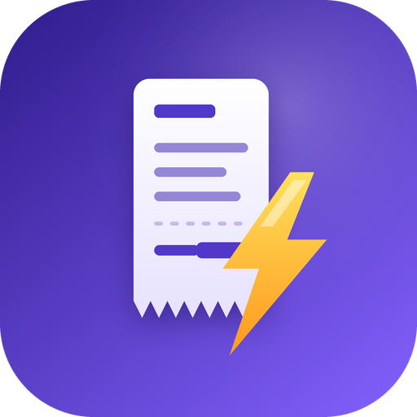
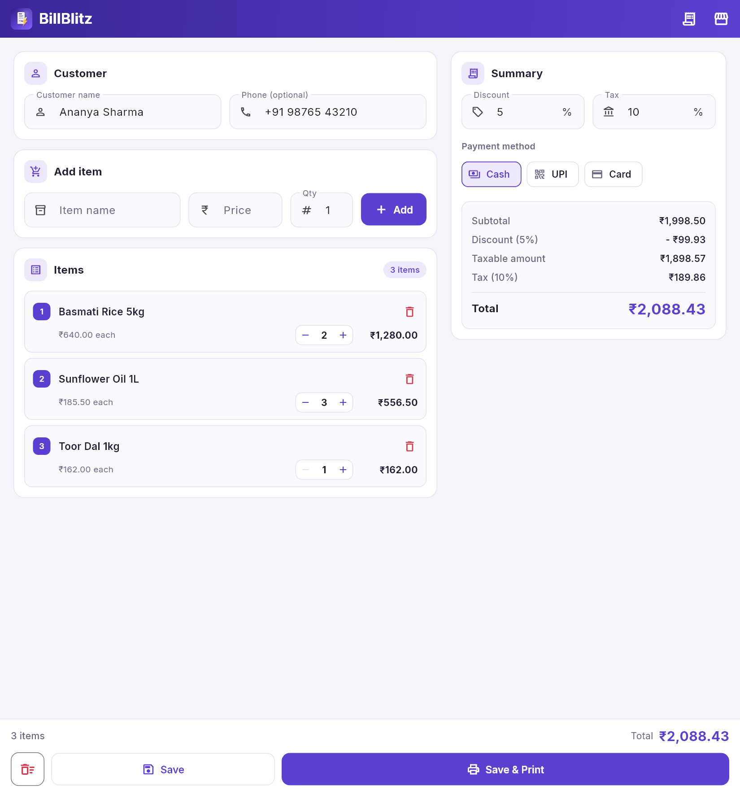
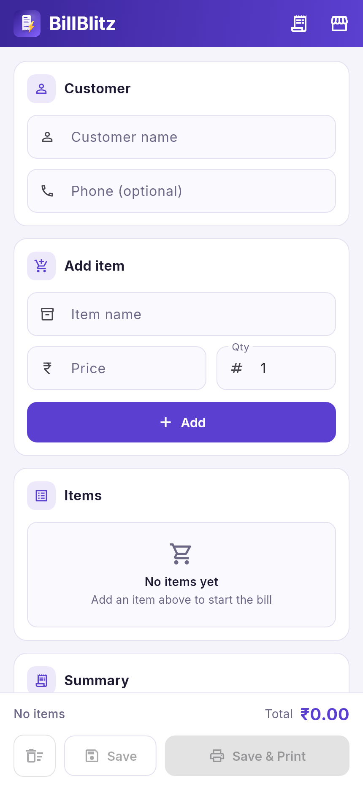
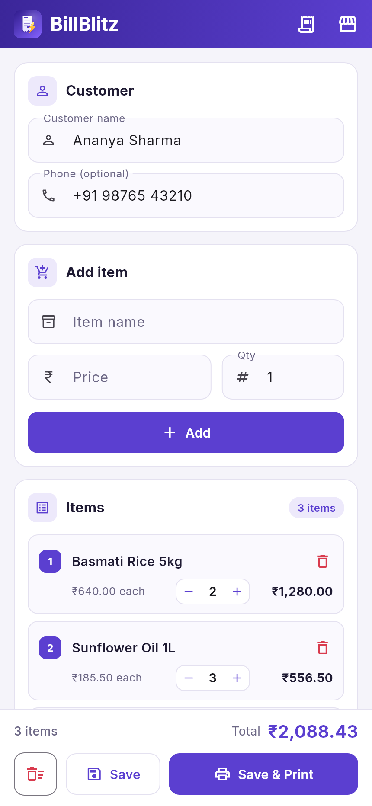
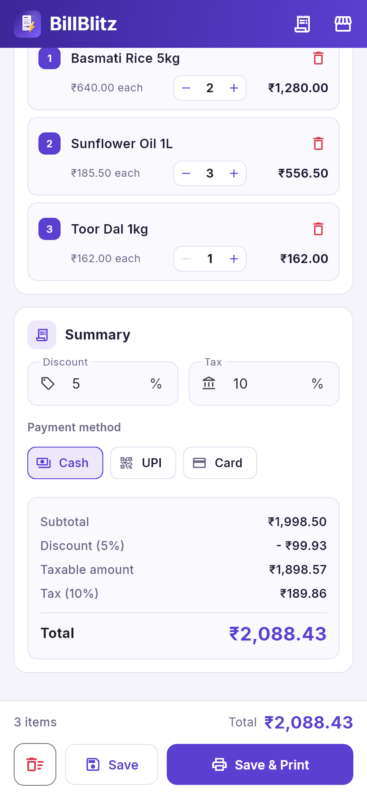
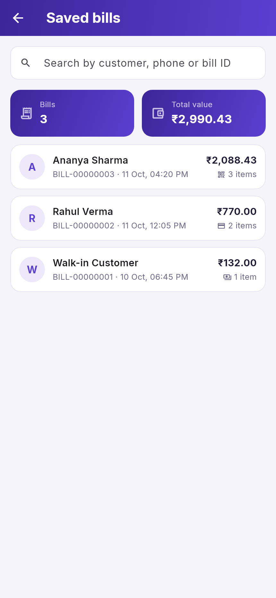
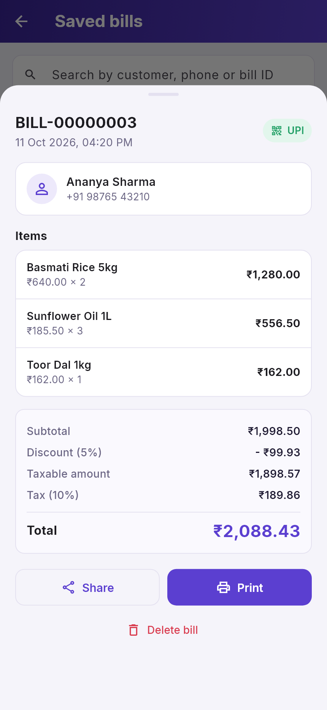
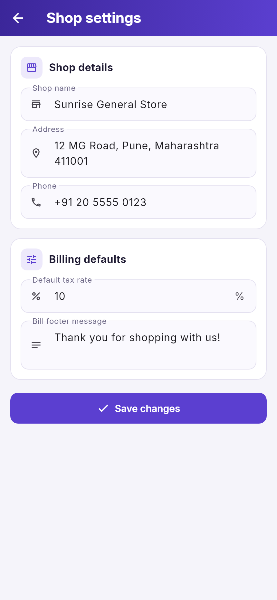
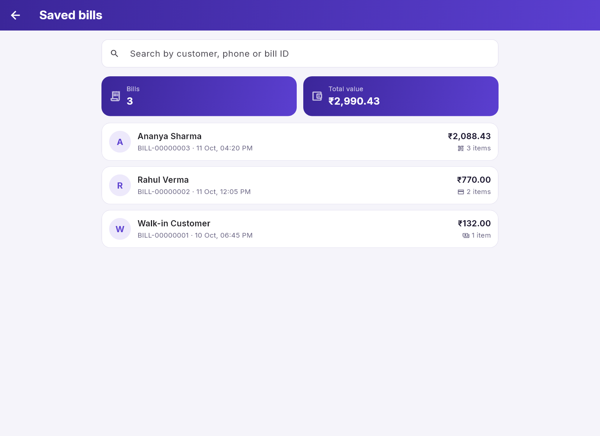
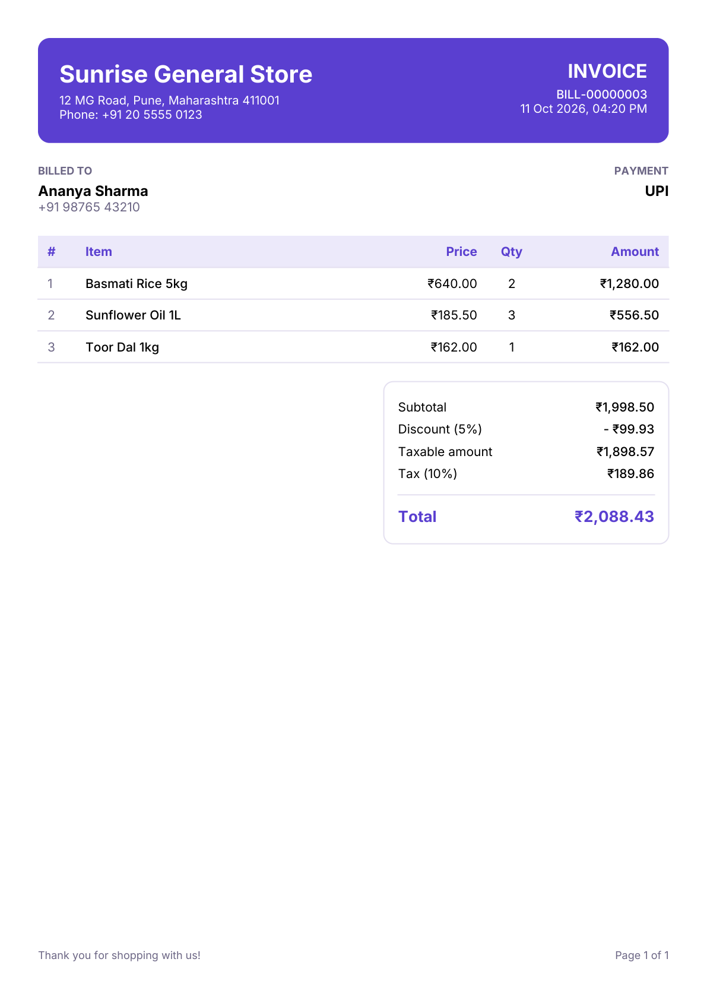

  

# BillBlitz ⚡

**Fast, clean billing for small shops.** BillBlitz is an app for creating customer bills in seconds, saving them to the cloud, and printing or sharing them as professional PDF invoices. It runs on Android, iOS, the web and Windows.

  

## 🎨 Logo and app icon

  

A torn-edge receipt struck by a lightning bolt: bills created in a flash. Royal purple with an amber bolt.

## ✨ Features

- **Quick billing** – add items with price and quantity, adjust quantities with a `− / +` stepper, and remove an item with one tap (with **Undo**).
- **Live totals** – subtotal, discount %, taxable amount, tax % and grand total update as you type. All maths lives in one tested calculator, so what you see is exactly what is saved and printed.
- **Payment method** – record each bill as Cash, UPI or Card.
- **Cloud storage** – bills are stored in Cloud Firestore with safe, sequential IDs (`BILL-00000001`, `BILL-00000002`, …) that can never collide, even when several devices save at once.
- **Saved bills** – search by customer, phone or bill ID, see the number of bills and their total value, open any bill for the full breakdown, and delete it if needed.
- **PDF invoices** – print or share (WhatsApp, e-mail, save to files) a branded A4 invoice with your shop name, address and phone. Multi-page for long bills. Reprinting an old bill always reproduces the original (same date, rates and totals).
- **Shop settings** – set your shop details, default tax rate and footer message once; they are used on every bill.
- **Indian-friendly formatting** – `₹` currency with lakh/crore digit grouping (`₹12,34,567.50`).
- **Responsive** – the phone layout is untouched; on wide screens (web and Windows, 960 px and up) the bill editor becomes two columns, with the customer and items on the left and a running summary on the right.
- **Works offline-first for fonts** – Inter ships with the app, so screens and PDFs render without a network request.

## 📸 Screenshots

<table>
  <tr>
    <td align="center"><b>New bill</b></td>
    <td align="center"><b>Items &amp; customer</b></td>
    <td align="center"><b>Summary &amp; payment</b></td>
  </tr>
  <tr>
    <td></td>
    <td></td>
    <td></td>
  </tr>
  <tr>
    <td align="center"><b>Saved bills</b></td>
    <td align="center"><b>Bill details</b></td>
    <td align="center"><b>Shop settings</b></td>
  </tr>
  <tr>
    <td></td>
    <td></td>
    <td></td>
  </tr>
</table>

### On the web and Windows

  
  &nbsp;
  

## PDF invoice

  

## 💻 Where it runs

| Platform | Supported |
| --- | --- |
| Android | Yes |
| iOS | Yes |
| Web (any modern browser) | Yes |
| Windows | Yes |

Phones use the compact mobile layout. On the web and Windows the app adapts to the wider window.

---

Built with 💥 by DarkWizardCK
